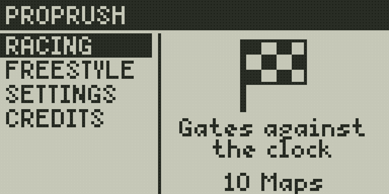
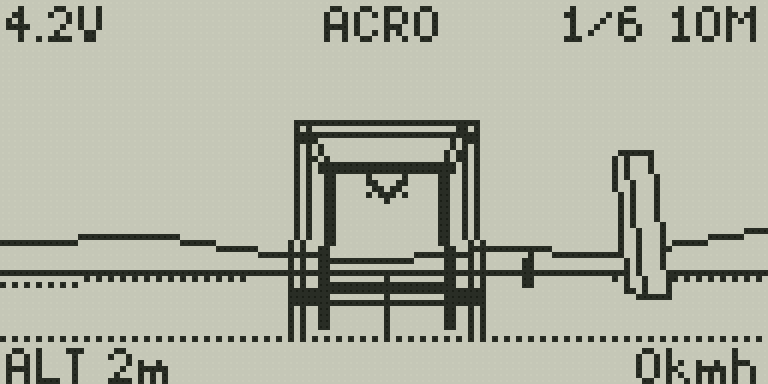
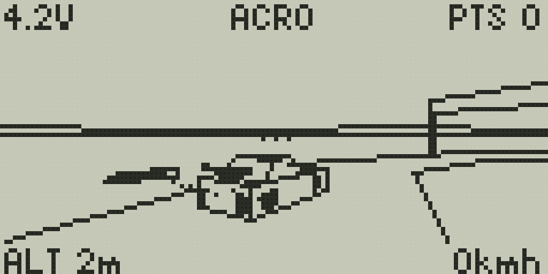
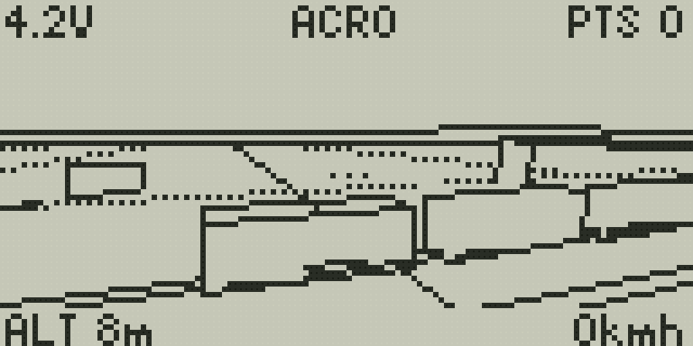

# PropRush

An FPV quad simulator that runs on your EdgeTX radio, flown with the radio's own sticks.

| | |
|---|---|
|  |  |
|  |  |

## Features

- **Racing:** 10 gate tracks against the clock, from figure eights to road circuits, with the best lap saved per track.
- **Freestyle:** 10 maps with something to fly around: chase a car drifting round a circuit, thread a moving train,
  dodge wind turbine blades, or dive through an old mill, a harbour and a city. Score flips, rolls, power loops,
  dives, hangs, gaps and proximity, with a combo multiplier.
- **Acro or Angle mode**, Betaflight rates per axis, and a settable camera angle and field of view.
- **A LiPo that sags and runs flat**, prop strikes and crashes when you clip things.
- **Your controls:** any stick, pot, slider or channel for each axis, and an optional arm switch.
- Sound and haptics.

## Requirements

EdgeTX 2.12.4 or later, on a radio with a black-and-white screen (128×64 or 212×64). Colour radios are planned.

## Install

1. Download `proprush-vX.Y.Z.zip` from the [latest release](https://github.com/jurgelenas/PropRush/releases/latest).
2. Extract it onto the root of the radio's SD card.
3. Open **PropRush** from the radio's Tools menu.

## Before you fly

- **Your sticks still drive the model.** The simulator reads the same sticks and switches as the active model, so
  disarm or turn RF off first, and pick an arm switch the model doesn't use.
- **For the best frame rate,** turn the internal and external RF modules off in the model setup while you play:
  the radio then has more CPU time for the game.

## Controls

Scroll with the wheel (or +/-), ENTER selects, EXIT goes back. In flight, EXIT pauses: from there you can change
settings and rates, restart or quit.

## Development

```sh
make install-tools  # stylua, lua-language-server, edgetx-luac into bin/
make check          # formatting and type checks
make test-host      # specs on the host Lua 5.3
make build          # release zip in dist/
```

## License

[GPL-3.0](LICENSE)
